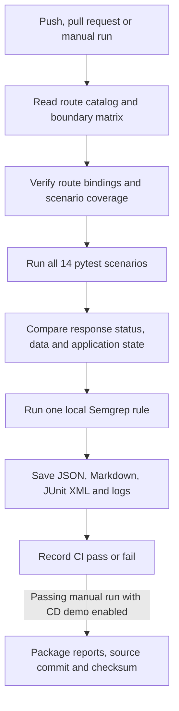

# Stefan Somin

**Application Security and AI Agent Security**

I build security tests for APIs, agent workflows and MCP integrations. I follow a request or action through the application, define the rule it must obey, and check the result against responses, logs and stored state.

My background is in Web3 security, including smart-contract permissions, cross-chain messages and accounting invariants. My current projects focus on AppSec testing and the systems behind AI agents.

[GitHub](https://github.com/Keedz1Off) · [Telegram](https://t.me/ETHkeedz1) · [Email](mailto:keedzyone@gmail.com)

## AppSec boundary workflow

My own testing pipeline uses a synthetic FastAPI notes application. Its matrix describes who is making a request, which action they try, and what should happen. A catalog links the registered API routes to that matrix.

For example, a rejected edit must leave the other user's note unchanged. The test checks the response and the stored note together.

| Part | What it does |
| --- | --- |
| Security invariant | States the rule the application must preserve, such as keeping another user's note unchanged after a rejected edit. |
| Boundary matrix | Records positive and negative scenarios with their expected results. |
| Route catalog | Checks that the application's routes have matrix bindings and scenarios. |
| Test scenario | Creates synthetic data and sends a request using the scenario's parameters. |
| Test oracle | Compares the response and resulting application state with the expected outcome. |
| Report | Preserves case results, observations, logs and the source version for review. |

**The hosted run passed all 14 pytest cases.** Semgrep checked one local rule across nine Python files, including the tests. The optional manual CD demo produces a downloadable archive of the verified reports.

Local calibration also runs two deliberately faulty versions. One returns HTTP 404 after changing the note. The state assertion detects the change.

Every hosted run currently executes the full matrix. The coverage check works on registered API routes. Selecting tests from changed functions remains planned.

[GitHub Actions in the private lab](https://github.com/Keedz1Off/appsec-boundary-workflow/actions/workflows/appsec.yml) · [Public LangGraph pipeline walkthrough](https://github.com/Keedz1Off/langgraph-pipeline-case-study#testing-pipeline)

## Selected investigations

| Project | What I checked and recorded |
| --- | --- |
| [LangGraph](https://github.com/Keedz1Off/langgraph-pipeline-case-study) | Ownership, tenant isolation, approval decisions and persistence in a synthetic host. The local assessment recorded 70 passes and three application consistency failures across 73 cases. |
| [FastMCP and MCP SDK](https://github.com/Keedz1Off/fastmcp-auth-state-sse-case-study) | The server rejected a revoked credential while the caller kept waiting. A comparison of selected SDK revisions verified prompt error delivery in the tested proposed fix. |
| [Browser Use](https://github.com/Keedz1Off/browser-use-agent-security-case-study) | In a direct local tool test, a policy error coexisted with a request recorded by the owned receiver. The case study documents the enforcement mismatch and the limits of the demonstrated impact. |
| [Learn with GenAI](https://github.com/Keedz1Off/learn-with-genai-resource-lifecycle-case-study) | SQLite connection and worker cleanup after chat completion. The same nine local regression tests changed from one pass to nine passes after the local patch. |
| [FastAPI mutation benchmark](https://github.com/Keedz1Off/fastapi-appsec-mutation-benchmark) | An independent static auditor identified all five deliberately introduced root causes. Recorded runtime controls cover ordinary HTTP requests. |
| [AI Agent Security Lab](https://github.com/Keedz1Off/ai-agent-security-lab) | Ten executable policy tests for tool permissions, document access, HTML text encoding and action limits. The seeded randomized check exercises 2,000 synthetic proposals. |

Start with a project's README. Its diagrams explain the application and testing flow. The linked matrices describe the rules, the test source contains the assertions, and the evidence records the observations. Each repository also explains what its current Actions workflow checks.

## How I work

I trace the application flow, identify the trust boundaries and write down the security invariants. Then I build scenarios, inspect the relevant state, investigate failed assertions and document the observed behavior.

AI helps with code analysis, test development and drafts. I check its suggestions against code and measurements. Reports include the tested revision, controls, results and limits.

My working tools include Python, pytest, FastAPI, SQLite, Git, JSON, YAML, Semgrep and GitHub Actions. The notes lab also has a Dockerfile and a local container runner configuration.

## Web3 background

[**Voxel Bench at ETHOnline 2026**](https://github.com/Keedz1Off/voxel-bench-sr01-case-study) includes my publicly credited SR-01 recipe-authorship finding and the team's upstream fix.

Earlier work covers bridge authorization, message flows and accounting rules.

- [Web3 security case collection](https://github.com/Keedz1Off/web3-security-portfolio)
- [Arbitrum Bridge](https://github.com/Keedz1Off/arbitrum-bridge-flow-local-review)
- [Optimism Bridge](https://github.com/Keedz1Off/optimism-bridge-flow-local-review)
- [Push Chain Gateway](https://github.com/Keedz1Off/push-chain-gateway-flow-local-review)
- [Solidity Audit Agent](https://github.com/Keedz1Off/solidity-audit-agent)

## Work with me

I am based in Lleida, Spain, and open to junior AppSec and AI security roles, internships and scoped contract work. I can walk through the pipeline, test code and recorded results during an interview.
